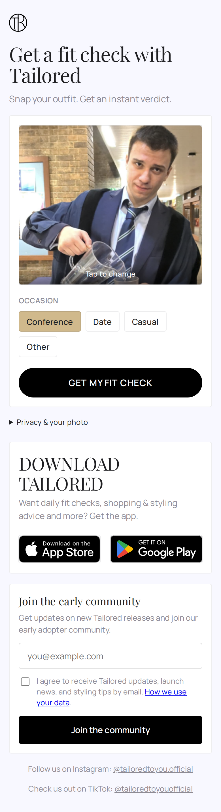
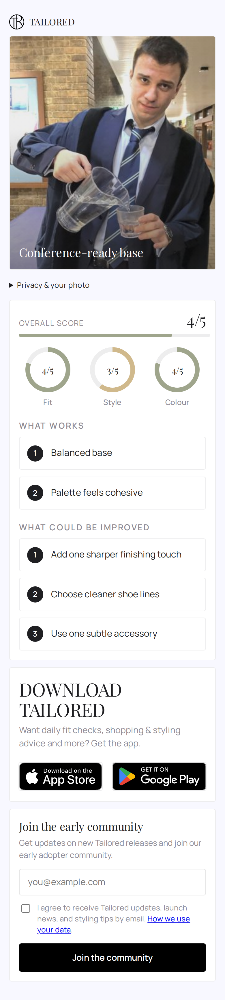
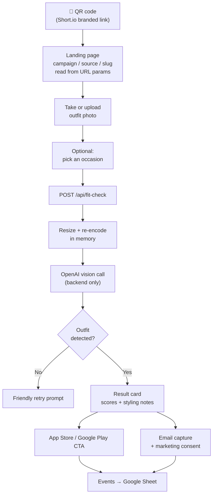
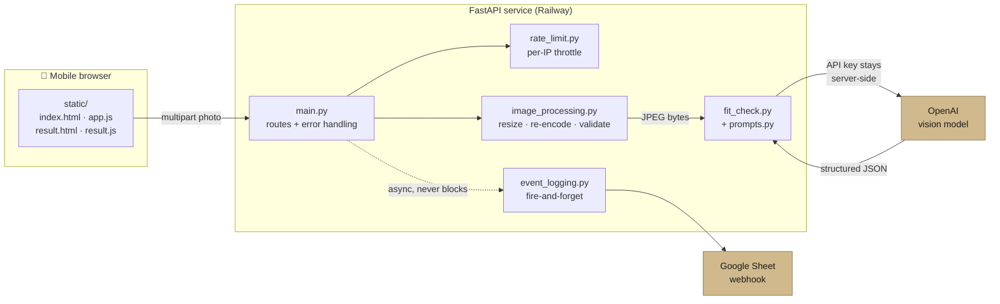

# Tailored Fit Check Campaign

[](https://github.com/ShuraStoilov98/tailored-fit-check-campaign/actions/workflows/ci.yml)
[](LICENSE)
[](https://www.python.org/)
[](https://fitcheck.tailored-to-you.com/?campaign=github_readme&source=readme)

A lightweight, no-login web app for Tailored's **Daily Fit Check** growth experiments.

Someone scans a QR code on a London street or at a conference, takes a photo of their outfit, and gets a short AI styling verdict in about 30 seconds — then sees an app download CTA and an email capture. Every step is tracked so we can tell which channels, locations, and hooks actually drive engagement.

This is deliberately **separate** from the main Tailored app: no Firebase Auth, no user profiles, no production database, and no photo storage.

---

## Try it

**[fitcheck.tailored-to-you.com](https://fitcheck.tailored-to-you.com/?campaign=github_readme&source=readme)** — best on a phone. Take a photo of what you're wearing and you'll get a verdict in a few seconds.

## Screens

| Landing | Result |
|---|---|
|  |  |

Screenshots use a [user-provided example photo](docs/images/outfit-example.png) and the local mock verdict. The feedback is illustrative, not a live AI assessment of the person shown. The original photo is unchanged; the app resizes and crops its display in the screenshots.

---

## How it works



## Architecture

A single FastAPI service that serves its own static frontend. One process, one deploy, no build step.



**Why this shape:** the backend resizes and re-encodes the photo to JPEG, sends it to OpenAI, and does not intentionally persist it in app storage or a database. FastAPI's multipart handling can spool uploads to temporary disk files. The browser keeps a preview in tab-scoped `sessionStorage` so the result page can display it. Event logging runs in the background; lead capture waits for the webhook so a failed save can be reported.

---

## Quick start

```bash
python -m venv .venv
source .venv/bin/activate
pip install -r requirements.txt

cp .env.example .env    # add your OPENAI_API_KEY
uvicorn app.main:app --reload --no-proxy-headers --no-access-log
```

Open <http://localhost:8000>.

Without an `OPENAI_API_KEY`, the app runs in **mock mode** locally and returns a canned verdict — handy for frontend work and for the test suite.

### Tests

```bash
pip install -r requirements-dev.txt
pytest -q
```

The suite is fully offline: no API key, no network, no spend.

---

## API

| Method | Route | Purpose |
|---|---|---|
| `GET` | `/` | Landing page |
| `GET` | `/result` | Result page |
| `GET` | `/health` | Liveness probe → `{"ok": true}` |
| `GET` | `/api/public-config` | App CTA URL (the only config the frontend sees) |
| `POST` | `/api/fit-check` | Photo in, structured verdict out |
| `POST` | `/api/lead` | Email capture, requires `marketing_consent` |
| `POST` | `/api/event` | Lightweight campaign event |

`POST /api/fit-check` takes a multipart `image` plus optional `occasion`, `campaign_id`, `source`, and `slug`, and returns:

```json
{
  "verdict_label": "Strong base",
  "one_line_verdict": "Clean tailoring with one sharper finishing touch to go.",
  "overall_score": 4,
  "fit_score": 4,
  "style_score": 4,
  "colour_score": 5,
  "what_works": ["Balanced proportions throughout", "Palette feels cohesive"],
  "improvements": [
    "Add one structured layer",
    "Choose a sharper shoe shape",
    "Try a single subtle accessory"
  ],
  "occasion_fit": "Conference-ready with one tweak.",
  "tailored_tip": "Build around pieces you already re-wear weekly."
}
```

Errors return a consistent shape, with a machine-readable code where one applies:

```json
{ "error": "No outfit detected. Please try again with a clear outfit photo.",
  "error_code": "NO_OUTFIT_DETECTED" }
```

| `error_code` | Status | Meaning |
|---|---|---|
| `NO_OUTFIT_DETECTED` | 422 | Photo has no clear outfit |
| `UNSUPPORTED_IMAGE_FORMAT` | 400 | Not a jpg/png/webp/heic, or undecodable |
| `IMAGE_TOO_LARGE` | 413 | Upload exceeds the byte or decoded-pixel limit |
| `REQUEST_TOO_LARGE` | 413 | JSON request exceeds 16 KB |
| `RATE_LIMITED` | 429 | Client or service request budget exceeded |

---

## Campaign tracking

Every page preserves `campaign_id`, `source`, and `short_link_slug` from the URL:

```text
https://fitcheck.tailored-to-you.com/?campaign=fit_conf_london_a&source=qr&slug=fit-conf-london-a
```

The public QR points at a branded Short.io link that redirects there, so clicks are counted before the page even loads:

```text
Short.io link → Fit Check page → events logged → app CTA → Short.io app link → App Store
```

**Events logged:** `page_view`, `photo_selected`, `fit_check_started`, `fit_check_completed`, `email_submitted`, `app_cta_clicked`, `google_play_cta_clicked`, `logo_clicked`, `error`.

Each event row carries:

```text
timestamp · event_type · campaign_id · source · slug · occasion
environment · success · error_message · app_version
verdict_label · overall_score · fit_score · style_score · colour_score
```

Lead rows add `email` and `marketing_consent`. Emails are collected **only** on the lead endpoint, never in event rows.

---

## Configuration

See [`.env.example`](.env.example).

| Variable | Required | Default | Notes |
|---|---|---|---|
| `OPENAI_API_KEY` | Yes in prod | — | Blank locally → mock mode |
| `OPENAI_MODEL` | No | `gpt-4o-mini` | Vision-capable model |
| `APP_STORE_CTA_URL` | No | Short.io link | Surfaced via `/api/public-config` |
| `GOOGLE_SHEET_WEBHOOK_URL` | No | — | Blank → event logging no-ops |
| `ENVIRONMENT` | No | `local` | `local` enables mock mode |
| `MAX_UPLOAD_MB` | No | `5` | Maximum incoming file size and normalized output, 1–20 MB |
| `FIT_CHECK_RATE_LIMIT` | No | `8` | Fit Checks per window per client |
| `LEAD_RATE_LIMIT` | No | `5` | Lead submits per window per client |
| `EVENT_RATE_LIMIT` | No | `60` | Browser events per window per client |
| `API_GLOBAL_RATE_LIMIT` | No | `240` | All API POST requests per window per process |
| `FIT_CHECK_GLOBAL_RATE_LIMIT` | No | `40` | Fit Check requests per window per process |
| `RATE_LIMIT_WINDOW_SECONDS` | No | `60` | Rate limit window |
| `TRUST_RAILWAY_PROXY` | No | `false` | Opt in to Railway ingress's validated `X-Real-IP` header; see deployment below |

---

## Security & privacy

The app is designed to keep campaign data separate from the main Tailored app:

* **The OpenAI key never leaves the backend.** `/api/public-config` exposes only the CTA URL, and a test asserts that.
* **No persistent server photo storage.** Multipart handling may use temporary files, and a preview is held in browser `sessionStorage` for the result page. The result page offers a way to clear it. Both pages explain data handling. Photos are sent to OpenAI for analysis; provider retention is separate from this app's storage behavior.
* **Event payloads omit images.** They contain campaign metadata and verdict scores. Browser event names and error codes are allowlisted; success events are emitted by the server. Keep personal data out of campaign parameters.
* **Email only with consent.** `/api/lead` rejects submissions without `marketing_consent`.
* **Requests are bounded before parsing.** File requests have a `MAX_UPLOAD_MB` budget plus 64 KB for multipart headers and fields; the file itself must fit `MAX_UPLOAD_MB`. Actual bytes are counted even without a reliable `Content-Length`. JSON is limited to 16 KB, and body reads time out after 30 seconds.
* **Uploads are decoded and re-encoded.** MIME types and actual decoded formats are checked, with extension fallback for generic uploads. Images over 20 megapixels are rejected before RGB conversion. The JPEG rewrite does not copy original EXIF metadata.
* **Basic process-local throttling** covers Fit Checks, leads, and events before parsing. Global caps also apply across clients. Stale client entries expire and the client table is bounded. Forwarded headers are ignored by default.
* **Client errors use friendly messages.** AI calls have a 30-second total deadline and no automatic retries. Application warnings omit raw model responses and upstream exception text. The documented server command disables access logs so IP addresses and URL parameters aren't recorded by Uvicorn; hosting-provider logs need separate access and retention controls.
* **Secrets are kept out of the image.** `.dockerignore` excludes `.env` and `.venv`, and the container runs as a non-root user.
* **CI runs lightweight secret checks.** Pushes to `main` and pull requests scan files and reachable Git history for environment files and common credential patterns, including Apps Script webhook URLs. Matches report locations, never secret values. Run `python scripts/check_secrets.py` locally. This is not an exhaustive secret detector.

### Operational limits

The limiter is intended for one worker on one Railway replica. Restarting resets budgets; adding workers or replicas multiplies them. Global caps bound traffic per window, not lifetime spend, and determined abuse can exhaust the allowance for legitimate visitors. Set provider spending limits and review traffic when promoting a campaign. Background event delivery is best effort and capped at 64 pending tasks; email capture still waits for a successful webhook response.

## Product guardrails

Fit Check feedback must be constructive, premium, concise, occasion-aware — and **never** body-critical or framed as attractiveness scoring. The system prompt in [`app/prompts.py`](app/prompts.py) forbids comments on body shape, weight, height, or attractiveness, and keeps the "fit" score about garment fit and cohesion rather than the wearer.

Scores are shown as `4/5` style sub-scores on outfit dimensions, not as a single "hot or not" rating.

---

## Deployment

Railway builds from the [`Dockerfile`](Dockerfile) and binds the platform port:

```bash
uvicorn app.main:app --host 0.0.0.0 --port $PORT --no-proxy-headers --no-access-log
```

Push to `main` and Railway redeploys. Set the environment variables in the Railway dashboard — never in the repo.

Set `ENVIRONMENT=production` and provide `OPENAI_API_KEY`. For a service reachable **only through Railway's public HTTP ingress**, set `TRUST_RAILWAY_PROXY=true` to use its [`X-Real-IP` client address](https://docs.railway.com/networking/public-networking/specs-and-limits). The app validates a single IP and ignores `X-Forwarded-For`. Keep Uvicorn's proxy rewriting disabled as in the command above. Leave this flag false on directly accessible servers or other hosting platforms; behind a proxy, the safe default shares the per-client allowance across that proxy's visitors. Global limits apply in both modes.

## Project layout

```text
app/
  main.py              FastAPI routes, error handlers, rate-limit wiring
  config.py            Env-backed settings
  schemas.py           Pydantic request/response models
  prompts.py           System prompt and tone guardrails
  fit_check.py         OpenAI vision call + response parsing
  image_processing.py  Validate, resize, re-encode uploads
  event_logging.py     Fire-and-forget webhook logging
  rate_limit.py        In-memory per-client throttle
  security.py          Request byte limits, deadlines, and API throttling before parsing
static/                index.html · result.html · app.js · result.js · styles.css
tests/                 Offline pytest suite
scripts/               Local and CI credential-pattern checks
docs/images/           README screenshots
```

## Success metrics

Hero metric: **Fit Checks completed per 100 QR scans.**

Funnel: QR scan → photo upload → fit check completed → app CTA click / email submitted.

## License

Code is licensed under [MIT](LICENSE). The user-provided example photo, including its appearance in the screenshots, is excluded from the MIT code license. The code license does not grant rights to Tailored, Apple, or Google trademarks.
