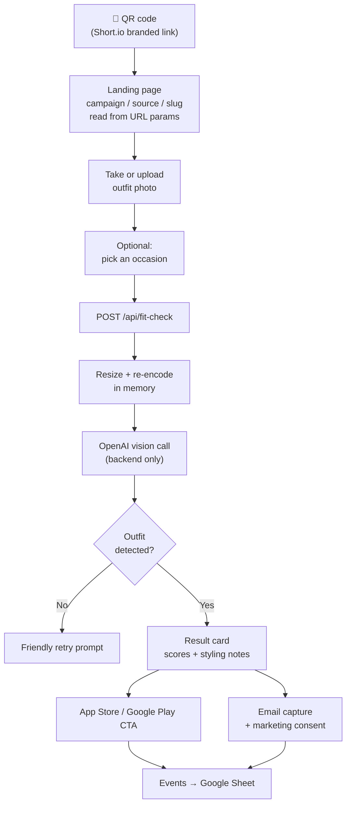
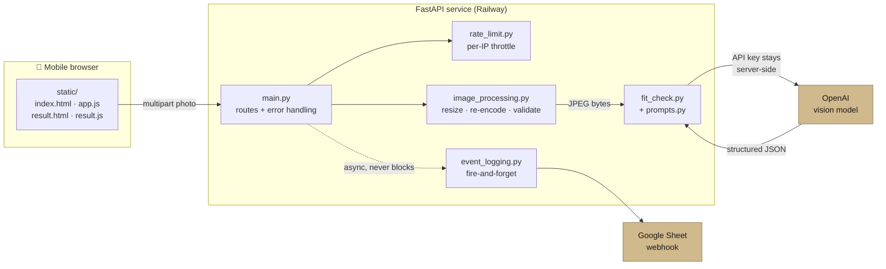

# Tailored Fit Check Campaign

[](https://github.com/ShuraStoilov98/tailored-fit-check-campaign/actions/workflows/ci.yml)
[](LICENSE)
[](https://www.python.org/)
[](https://fitcheck.tailored-to-you.com/?campaign=github_readme&source=readme)

A lightweight, no-login web app for Tailored's **Daily Fit Check** growth experiments.

Someone scans a QR code on a London street or at a conference, takes a photo of their outfit, and gets a short AI styling verdict in about 30 seconds — then sees an app download CTA and an email capture. Every step is tracked so we can tell which channels, locations, and hooks actually drive engagement.

This is deliberately **separate** from the main Tailored app: no Firebase Auth, no user profiles, no production database, and no photo storage.

---

## Try it

**[fitcheck.tailored-to-you.com](https://fitcheck.tailored-to-you.com/?campaign=github_readme&source=readme)** — best on a phone. Take a photo of what you're wearing and you'll get a verdict in a few seconds.

## Screens

| Landing | Result |
|---|---|
|  |  |

Screenshots use an openly licensed example photo and the local mock verdict; the feedback is illustrative, not a live AI assessment of the person shown. Photo: [TellusFashion](https://www.tellusfashion.com/), [Street Style at London Fashion Week 04](https://commons.wikimedia.org/wiki/File:Street_Style_at_London_Fashion_Week_04.jpg), [CC BY 2.0](https://creativecommons.org/licenses/by/2.0/), via Wikimedia Commons ([original Flickr source](https://www.flickr.com/photos/75075293@N02/6755037861/)). The [bundled original](docs/images/outfit-example.jpg) is unchanged; the app resizes and crops its display in the screenshots. No endorsement is implied.

---

## How it works



## Architecture

A single FastAPI service that serves its own static frontend. One process, one deploy, no build step.



**Why this shape:** the backend resizes and re-encodes the photo to JPEG, sends it to OpenAI, and does not intentionally persist it in app storage or a database. FastAPI's multipart handling can spool uploads to temporary disk files. The browser keeps a preview in tab-scoped `sessionStorage` so the result page can display it. Event logging runs in the background; lead capture waits for the webhook so a failed save can be reported.

---

## Quick start

```bash
python -m venv .venv
source .venv/bin/activate
pip install -r requirements.txt

cp .env.example .env    # add your OPENAI_API_KEY
uvicorn app.main:app --reload
```

Open <http://localhost:8000>.

Without an `OPENAI_API_KEY`, the app runs in **mock mode** locally and returns a canned verdict — handy for frontend work and for the test suite.

### Tests

```bash
pip install -r requirements-dev.txt
pytest -q
```

The suite is fully offline: no API key, no network, no spend.

---

## API

| Method | Route | Purpose |
|---|---|---|
| `GET` | `/` | Landing page |
| `GET` | `/result` | Result page |
| `GET` | `/health` | Liveness probe → `{"ok": true}` |
| `GET` | `/api/public-config` | App CTA URL (the only config the frontend sees) |
| `POST` | `/api/fit-check` | Photo in, structured verdict out |
| `POST` | `/api/lead` | Email capture, requires `marketing_consent` |
| `POST` | `/api/event` | Lightweight campaign event |

`POST /api/fit-check` takes a multipart `image` plus optional `occasion`, `campaign_id`, `source`, and `slug`, and returns:

```json
{
  "verdict_label": "Strong base",
  "one_line_verdict": "Clean tailoring with one sharper finishing touch to go.",
  "overall_score": 4,
  "fit_score": 4,
  "style_score": 4,
  "colour_score": 5,
  "what_works": ["Balanced proportions throughout", "Palette feels cohesive"],
  "improvements": [
    "Add one structured layer",
    "Choose a sharper shoe shape",
    "Try a single subtle accessory"
  ],
  "occasion_fit": "Conference-ready with one tweak.",
  "tailored_tip": "Build around pieces you already re-wear weekly."
}
```

Errors return a consistent shape, with a machine-readable code where one applies:

```json
{ "error": "No outfit detected. Please try again with a clear outfit photo.",
  "error_code": "NO_OUTFIT_DETECTED" }
```

| `error_code` | Status | Meaning |
|---|---|---|
| `NO_OUTFIT_DETECTED` | 422 | Photo has no clear outfit |
| `UNSUPPORTED_IMAGE_FORMAT` | 400 | Not a jpg/png/webp/heic, or undecodable |
| `IMAGE_TOO_LARGE` | 400 | Could not compress under the limit |
| `RATE_LIMITED` | 429 | Too many requests from one client |

---

## Campaign tracking

Every page preserves `campaign_id`, `source`, and `short_link_slug` from the URL:

```text
https://fitcheck.tailored-to-you.com/?campaign=fit_conf_london_a&source=qr&slug=fit-conf-london-a
```

The public QR points at a branded Short.io link that redirects there, so clicks are counted before the page even loads:

```text
Short.io link → Fit Check page → events logged → app CTA → Short.io app link → App Store
```

**Events logged:** `page_view`, `photo_selected`, `fit_check_started`, `fit_check_completed`, `email_submitted`, `app_cta_clicked`, `google_play_cta_clicked`, `logo_clicked`, `error`.

Each event row carries:

```text
timestamp · event_type · campaign_id · source · slug · occasion
environment · success · error_message · app_version
verdict_label · overall_score · fit_score · style_score · colour_score
```

Lead rows add `email` and `marketing_consent`. Emails are collected **only** on the lead endpoint, never in event rows.

---

## Configuration

See [`.env.example`](.env.example).

| Variable | Required | Default | Notes |
|---|---|---|---|
| `OPENAI_API_KEY` | Yes in prod | — | Blank locally → mock mode |
| `OPENAI_MODEL` | No | `gpt-4o-mini` | Vision-capable model |
| `APP_STORE_CTA_URL` | No | Short.io link | Surfaced via `/api/public-config` |
| `GOOGLE_SHEET_WEBHOOK_URL` | No | — | Blank → event logging no-ops |
| `ENVIRONMENT` | No | `local` | `local` enables mock mode |
| `MAX_UPLOAD_MB` | No | `5` | Compression target |
| `FIT_CHECK_RATE_LIMIT` | No | `8` | Fit Checks per window per client |
| `LEAD_RATE_LIMIT` | No | `5` | Lead submits per window per client |
| `RATE_LIMIT_WINDOW_SECONDS` | No | `60` | Rate limit window |

---

## Security & privacy

The app is designed to keep campaign data separate from the main Tailored app:

* **The OpenAI key never leaves the backend.** `/api/public-config` exposes only the CTA URL, and a test asserts that.
* **No persistent server photo storage.** Multipart handling may use temporary files, and a preview is held in browser `sessionStorage` for the result page. Photos are sent to OpenAI for analysis; provider retention is separate from this app's storage behavior.
* **Event payloads omit images.** They contain campaign metadata and verdict scores. Keep personal data out of campaign parameters and free-text event fields.
* **Email only with consent.** `/api/lead` rejects submissions without `marketing_consent`.
* **Uploads are decoded and re-encoded.** The content type is checked, with extension fallback for generic uploads, then Pillow decodes and rewrites the image as JPEG. Original EXIF metadata is not copied to the output.
* **Basic process-local throttling** covers Fit Checks and leads; see the limitations below before exposing the service broadly.
* **Client errors use friendly messages.** Server logs still need appropriate access controls and retention.
* **Secrets are kept out of the image.** `.dockerignore` excludes `.env` and `.venv`, and the container runs as a non-root user.
* **CI runs lightweight secret checks.** Pushes to `main` and pull requests check for a tracked root `.env` and several credential patterns in the current tracked files. This does not scan Git history or detect every secret format.

### Known limitations before broad promotion

* `MAX_UPLOAD_MB` currently limits the normalized output, not the incoming request body. Enforce a request-size limit before multipart parsing to bound memory and temporary-disk use.
* The throttle trusts the first `X-Forwarded-For` value. Configure a trusted proxy boundary before relying on it for spend protection. The limiter's stale-key cleanup also needs correction, and `/api/event` has no throttle or event-name allowlist.
* The capture and result pages need a clear privacy notice explaining image processing, browser previews, analytics, and email collection before a wider campaign launch.

## Product guardrails

Fit Check feedback must be constructive, premium, concise, occasion-aware — and **never** body-critical or framed as attractiveness scoring. The system prompt in [`app/prompts.py`](app/prompts.py) forbids comments on body shape, weight, height, or attractiveness, and keeps the "fit" score about garment fit and cohesion rather than the wearer.

Scores are shown as `4/5` style sub-scores on outfit dimensions, not as a single "hot or not" rating.

---

## Deployment

Railway builds from the [`Dockerfile`](Dockerfile) and binds the platform port:

```bash
uvicorn app.main:app --host 0.0.0.0 --port $PORT
```

Push to `main` and Railway redeploys. Set the environment variables in the Railway dashboard — never in the repo.

## Project layout

```text
app/
  main.py              FastAPI routes, error handlers, rate-limit wiring
  config.py            Env-backed settings
  schemas.py           Pydantic request/response models
  prompts.py           System prompt and tone guardrails
  fit_check.py         OpenAI vision call + response parsing
  image_processing.py  Validate, resize, re-encode uploads
  event_logging.py     Fire-and-forget webhook logging
  rate_limit.py        In-memory per-client throttle
static/                index.html · result.html · app.js · result.js · styles.css
tests/                 Offline pytest suite
docs/images/           README screenshots
```

## Success metrics

Hero metric: **Fit Checks completed per 100 QR scans.**

Funnel: QR scan → photo upload → fit check completed → app CTA click / email submitted.

## License

Code is licensed under [MIT](LICENSE). The example outfit photo, including its appearance in the screenshots, remains under [CC BY 2.0](https://creativecommons.org/licenses/by/2.0/) with the attribution above. The code license does not grant rights to Tailored, Apple, or Google trademarks.
